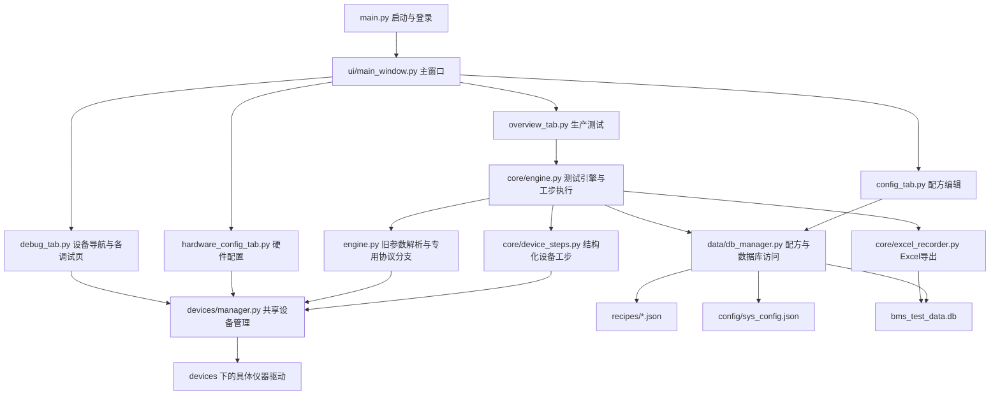
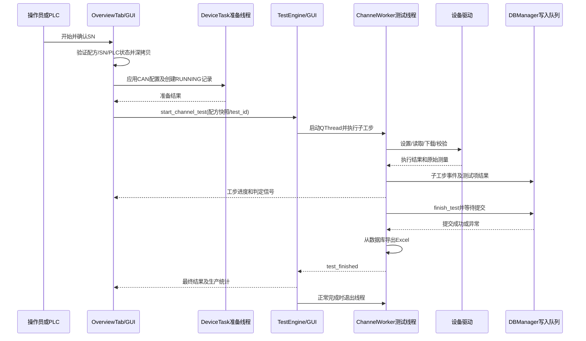

# 软件框架、调用流程与检查台账

依据当前源码梳理，日期 2026-10-15。本文描述实际实现，不将计划能力视为已有功能。文件路径相对项目根目录；函数名用于定位，避免后续修改导致行号失效。

## 1. 整体框架

这是 PySide6 桌面程序，当前自动测试以单条测试序列为入口。配方为“测试项 → 子工步”两层，设备的物理多通道仍保留。

实际分层尚未完全解耦：DBManager 同时负责 SQLite、配方文件、系统配置和用户；ChannelWorker 同时负责调度、旧工步解析、部分仪器调用和判定。梳理检查应覆盖这些交叉职责，不能只检查 drivers。

## 2. 按运行顺序展开调用

| 顺序 | 触发与调用链 | 主要文件 | 检查要点 |
|---|---|---|---|
| F01 启动 | main → setup_crash_logging → QApplication → 样式及滚轮保护 | main.py；ui/parameter_wheel_guard.py | 资源路径、异常记录、输入误触 |
| F02 登录 | _authenticate_user → LoginDialog.handle_login → DBManager.verify_user → 初始密码修改 → set_current_user | ui/dialogs/login_dialog.py；password_change.py；core/passwords.py；user_session.py；data/db_manager.py | 密码验证、账号消失、失败是否放行 |
| F03 自检 | MainWindow.__init__ → DeviceManager.update_config → StartupCheckDialog → InitWorker.run → init_all_devices → 各驱动.connect | ui/main_window.py；ui/dialogs/startup_dialog.py；devices/manager.py | 单设备故障隔离、身份验证、取消、自检线程结束后进入 |
| F04 主界面 | MainWindow._init_ui → OverviewTab / ConfigTab / HardwareConfigTab / DebugTab → apply_role_permissions | ui/main_window.py；ui/tabs 下各页面 | 实际账户权限、忙碌期间限制、初始化副作用 |
| F05 配方编辑 | 选中配方 → load_recipe_to_tree → 测试项/工步对话框 → save_recipe 或 save_recipe_as → save_recipe_json | ui/tabs/config_tab.py；ui/dialogs/test_item_dialog.py；step_dialog.py；ui/widgets/device_step_form.py；data/db_manager.py | 两层结构、工步身份、复制、保存字段一致性 |
| F06 配方载入 | update_recipes → on_recipe_combo_changed → load_recipe_from_file → single_channel_items → 只读测试树 | ui/tabs/overview_tab.py；core/single_channel_recipe.py | 加载失败不得保留可执行旧序列，界面和实际配方一致 |
| F07 PLC 配方同步 | 用户主动选择 → sync_recipe_number_to_plc → _drain_plc_recipe → PLC寄存器0写入及回读 | overview_tab.py；devices/easy320_driver.py | 只有主动选择同步；确认未完成不得启动 |
| F08 启动测试 | 开始按钮或 PLC → request_scan_and_start → start_single_channel_test → 条码规则验证 → 深拷贝配方及操作员 | overview_tab.py；core/user_session.py | 条码、空序列、重复启动、配方快照 |
| F09 测试准备 | DeviceTask → _prepare_run → _apply_recipe_hardware → CAN配置 → start_new_test → _launch_prepared_test | overview_tab.py；ui/device_task.py；devices/pcan_fd_driver.py；data/db_manager.py | 取消、连接失败、准备记录终止、不得重复创建记录 |
| F10 引擎启动 | TestEngine.start_channel_test → TestStep/SubStep → ChannelWorker.moveToThread → QThread.started → start | core/engine.py；core/recipe_identity.py | 配方类型、稳定身份、线程所有权、启动失败 |
| F11 工步执行 | run_next_step → run_next_sub_step → execute_sub_step → _execute_sub_step_logic | core/engine.py | 超时、失败停止/忽略/重试、等待可取消 |
| F12 设备/协议分派 | 结构化参数 → device_steps.execute；旧工步 → 旧解析/专用辅助模块 → 共享驱动 | core/device_steps.py；engine.py；下表专用模块 | 不只看命令发送成功，检查回读与实际值 |
| F13 判定记录 | on_step_complete → 选取判定值 → 数值/字符串/不判断 → 项目复测 → log_item_result → step_finished | core/engine.py；core/numeric_validation.py；measurement_units.py；data/db_manager.py | NaN/空值、上下限、复测结果、单位、数据库失败 |
| F14 完成 | run_next_step结束 → finish_test → _export_excel_record → test_finished → 引擎转发 → on_worker_test_finished | engine.py；db_manager.py；core/excel_recorder.py；overview_tab.py | 数据落盘先于完成；报表与数据库一致；记录异常不当PASS |
| F15 统计 | on_worker_test_finished → ProductionStatistics.record/counts → 刷新合格率 | overview_tab.py；core/production_statistics.py | 同条码按最新完成结果、运行ID去重、停止是否计数 |
| F16 停止 | stop_single_channel_test → TestEngine.stop_test → request_stop → cancel_event及queued stop → _perform_stop | overview_tab.py；engine.py；devices/manager.py | 中断后不再开启、输出关闭确认、STOPPED/NG/RECORD_ERROR |
| F17 退出 | MainWindow.closeEvent → 停止引擎/准备 → request_ui_shutdown → _poll_shutdown → 输出清理 → disconnect_all → DBManager.close → close | ui/main_window.py；ui/async_shutdown.py；ui/device_task.py | 不在GUI等待通信、原生线程退完再释放、失败不静默 |

主界面名称仍有部分 Channel 字样，是代码兼容命名，不代表现在启用了多条自动测试通道。

### 两条独立的控制入口

- 硬件配置应用：HardwareConfigTab.save_config → DBManager.save_sys_config → core/system_config.update 原子保存 → run_operation/DeviceTask → safe_shutdown_outputs → disconnect_all → DeviceManager.update_config；点击初始化时继续 init_all_devices。**文件已保存与运行对象已应用是不同阶段**，后者失败时前者可能已经完成，应核对提示和实际驱动参数。
- 手动调试：MainWindow._init_ui 创建各页面并注入 DeviceManager → 页面按钮处理函数 → DeviceTask或专用采集线程 → 共享驱动 → 信号回GUI。各页面的运行时配置、连接、状态回读与自动工步参数不是同一个函数，检查时分别执行。

## 3. 自动执行时序与返回路径

正常完成和用户停止不是同一路径：正常完成后不自动套用停止的关断逻辑，输出由配方负责；停止时调用 safe_shutdown_outputs。普通停止按既定策略保留 DUT 供电，emergency=True 才包含 DUT 关断。

## 4. 设备、调试页面与协议文件对应

| 设备/功能 | 调试页面 ui/tabs/ | 驱动及辅助文件 |
|---|---|---|
| 电池模拟器，最多6台，每台最多24通道 | simulator_tab.py | devices/ngi_83624.py；simulator_config.py；simulator_batch.py；core/simulator_commands.py |
| NGI高压源 | hv_tab.py | devices/ngi_n3618.py |
| IT6722A被测物电源 | mainboard_power_tab.py | devices/itech_it6722a.py |
| IT6333B三通道电源 | it6333b_tab.py | devices/itech_it6333b.py |
| EASY320 | easy320_tab_standalone.py | devices/easy320_driver.py；core/easy320_channels.py |
| CA550 | ca550_tab_standalone.py | devices/ca550_driver.py |
| PCAN / ZLG网络CAN及UDS | pcan_fd_tab.py | devices/pcan_fd_driver.py；zlg_net_bus.py；uds_client.py；core/uds_parser.py；uds_dictionary.py |
| BMS专用EOL/CSC/DTC | 由工步及CAN协议入口使用 | devices/eol_protocol.py；core/engine.py._execute_eol_protocol；故障码.txt |
| 力捷丰SG400 | opteeq_tab.py | devices/opteeq_sg400.py；core/burn_recorder.py |
| 瑞萨E2 | renesas_e2_tab.py | devices/renesas_e2_rfp.py；core/renesas_verify.py；background_process.py |
| APP刷写 | app_flash_tab.py | core/app_flash_step.py；flash_progress.py；background_process.py |
| 34461A万用表 | multimeter_tab.py | devices/keysight_34461a.py |
| DG2052信号发生器 | dg2052_tab.py | devices/rigol_dg2052.py |
| TBS2102B示波器 | tbs2102b_tab.py | devices/tektronix_tbs2102b.py |
| 绝缘/Relay/HV/HSD/DMM板 | board_debug_tab.py | devices/rn_board.py；doc/板卡协议/ |
| 6块电阻板组合36通道 | resistor_bank_tab.py | devices/rn_board.py；resistor_bank.py |
| MES | mes_tab.py | core/mes_client.py；自动工步分支在engine.py |

多数调试操作通过 DeviceTask 执行；部分连续采集及UDS任务使用页面专用 QThread。共享连接由主窗口创建的 DeviceManager 提供，但页面还存在各自处理逻辑，不能推断“调试通过等于自动工步通过”。两条入口必须分别核对。

## 5. 线程与数据归属

| 执行位置 | 主要职责 | 回到GUI/结束方式 |
|---|---|---|
| GUI主线程 | 窗口、树表、权限、统计、TestEngine协调 | Qt事件循环 |
| InitWorker QThread | 启动时串行连接设备 | 日志/完成信号；wait(0)确认原生退出 |
| DeviceTask后台线程 | 调试命令、测试准备、PLC操作、配置应用 | _TaskRuntime → DeviceTask._result；应用持有运行时生命周期 |
| ChannelWorker QThread | 顺序工步、设备调用、判定、结束入库及报表 | 工步/完成信号；引擎保留引用到原生线程结束 |
| CAN接收Python线程 | 接收报文、队列、历史及订阅分发 | stop Event隔离连接代次；disconnect关闭总线并join |
| SQLite写入Python线程 | 串行消费DBManager队列并commit | 需确认的操作使用Event等待；close投递哨兵并检查排空 |
| 退出清理Python线程 | 关输出、断设备、关数据库 | GUI定时轮询，失败提示或明确选择继续退出 |

| 数据 | 位置/身份 | 说明 |
|---|---|---|
| 系统硬件配置 | config/sys_config.json | core/system_config.py加锁及原子替换；含敏感设置，审查不输出内容 |
| 配方 | recipes/*.json | DBManager相邻目录；测试项与子工步的step_id由core/recipe_identity.py维护，配方仍主要按文件名识别 |
| 测试记录 | bms_test_data.db | test_main、test_items_results、test_step_events等；test_id关联 |
| 运行中变量和尝试 | ChannelWorker.variables/results_by_id | execution_id区分一次运行，step_id区分工步 |
| 生产统计 | ProductionStatistics内存 | 当前会话统计，可按条码去重；不等同数据库历史总量 |
| Excel | 测试记录/项目号/日期/*.xlsx | 从已提交数据库记录导出 |
| 烧录留痕 | logs/burn_records/ | core/burn_recorder.py输出，区别于整机测试Excel |
| 崩溃和排查日志 | logs/ | main.py、core/debug_trace.py、startup_diagnostics.py及测试工具 |

## 6. 按流程检查的固定方法

每条链按“输入 → 校验 → 线程切换 → 设备请求 → 回读 → 判定 → 写入 → GUI → 清理”核对，记录具体函数、复现条件、期望结果及测试，不用“测试全绿”代替调用链审查。

| 流程组 | 当前检查证据 | 后续核对重点 |
|---|---|---|
| F01–F04 登录/初始化 | 已有入口与初始化专项修复和测试 | 构造失败、配置损坏、退出与自检竞争 |
| F05–F09 配方到准备 | 本次沿链检查，发现另存字段丢失及加载失败保留旧序列 | 配方选择与实际执行一致、输入失败阻断 |
| F10–F13 调度与判定 | 已有停止/复测、CSC/DTC、无效测量专项回归 | 每种子工步失败策略及变量传播分别检查 |
| F14–F15 留存与统计 | 已有DB延迟提交、Excel原子保存、条码去重回归 | 事件重复、取消与完成交错、导出异常展示 |
| F16–F17 停止退出 | 已有输出清理及Qt生命周期回归 | 真实仪器失联、底层超时、驱动原生资源释放 |

这些状态表示已有源码检查和测试证据，不表示每种实机行为已经验证。没有现场通信证据的项目仍需硬件联调。

## 7. 本次沿流程发现的问题

问题、修复和验证结果在本节更新；不将其他历史文档中的问题重复计为本次新发现。

- P01，F05：save_recipe_as → _collect_recipe_data 未带 sn_regex，普通保存却携带该字段。另存后的配方会丢失条码规则。
- P02，F06：加载不存在或损坏配方时，错误分支未清除旧的 current_recipe_data 与测试树，选择的名称可能与可执行序列不一致。
- P03，F06：配置目录中配方不存在时，会退到源码 recipes 目录寻找同名文件，可能使用非当前配置来源的序列。

修复：普通保存和另存为共用 _collect_recipe_data，保留 sn_regex；加载失败和配方列表清空均清除执行状态及旧扫码确认；从配置目录解析配方，不再跨目录查找同名文件。

新增 tests/test_recipe_flow_audit.py。先复现另存丢字段和缺失配方问题，再覆盖 JSON 损坏、结构异常、部分树构造失败、删除配方、列表清空及目录来源。全量回归：687 passed，244 subtests passed，耗时34.77秒；修改文件静态检查通过。

本次完成框架和调用链梳理，并沿F05–F06修复三个确认问题；其他流程已有的历史测试证据已在台账区分列出，不能视为本次把所有仪器实机重新测试了一遍。未打包、未推送、未操作现场硬件。

## 8. 后续三轮审查

用户要求按正常、异常、交错操作三个视角再次检查，已完成，记录见《三轮流程审查_20261015.md》。新增修复：旧配方被注入条码规则、编辑器读取失败保留旧内容并可能保存到错误名称、关闭与扫码/开始请求交错。三轮完整回归分别通过688、693、697项测试，每轮244个子测试。最终源代码状态对应第三轮697项测试。

随后沿F11–F13继续发现旧工步未知设备误报成功、EASY320空/非法通道处理、旧式模拟器非有限读数及异常原因丢失，修复和验证见《工步分派误报成功修复_20261015.md》，该次完整回归712项测试、244个子测试通过。

继续检查F11–F13的输出控制，提取core/legacy_controls.py，修复旧式高压源/IT6722A/CA550的取消后开启、设置异常阻止OFF、CA550非法值及跨字段误判；详见《旧工步输出安全修复_20261015.md》。完整回归729项测试、244个子测试通过。

## 9. 控制入口收敛第一批

新增core/instrument_control.py，将高压源、IT6722A、CA550主要源控制从调试页、新旧自动工步、初始化及停止清理接到共同控制边界。底层协议和物理回读仍在原驱动；CA550高级功能及其他型号未在本批整体迁移。控制流程和逐设备验收矩阵见《设备控制入口收敛_20261015.md》。框架图中这些控制调用现在经共同层再到驱动，设备读取和未迁移功能仍可直接使用共享驱动。
