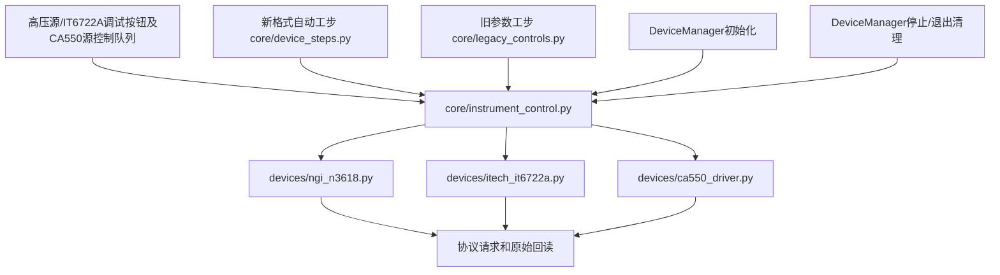

# 设备控制入口收敛：第一批

本批覆盖NGI高压源、IT6722A被测物电源、CA550源输出的主要控制入口。不是全体仪器已经实机验收完成；其余设备后续按同样矩阵迁移，不能用新增一个公共文件代替入口核对。

## 当前共同入口

新增 core/instrument_control.py：

- connect_instrument：连接返回确认及取消检查，实际身份握手仍由驱动执行。
- control_power：高压源与IT6722A的设压、设流、输出、清保护。
- control_calibrator：CA550源功能、源量程、设定值、输出控制。
- shutdown_calibrator：归零和OFF分别执行并汇总错误，归零失败仍尝试OFF。
- instrument_transaction：使用同一驱动的可重入锁，允许复合工步将设置与开启作为一组控制。

## 入口逐项对应

| 场景 | 高压源/IT6722A | CA550 |
|---|---|---|
| 初始化连接 | manager.init_all_devices → connect_instrument | 同左 |
| 手动调试 | hv_tab/mainboard_power_tab → control_power | CA550SerialWorker源操作 → control_calibrator |
| 旧配方 | execute_power → control_power，整组持有驱动锁 | execute_calibrator → control_calibrator，整组持有驱动锁 |
| 新格式工步 | device_steps.execute输出控制 → control_power | 当前目录提供连接工步；源操作仍走已有旧配方入口，不虚构新的CA550动作 |
| 停止清理 | safe_shutdown_outputs → control_power OFF | safe_shutdown_outputs → shutdown_calibrator |
| DUT保电 | 普通停止仍保留DUT；emergency=True才关闭 | 不适用 |

读数、原始SCPI调试、CA550背光/24V辅助电源/测量等高级操作仍由原驱动承担。本批共同层统一源输出控制规则，没有把不同仪器的所有功能伪装成同一种命令。

## 集中规则与本次行为变化

1. 参数有限性和动作白名单集中校验；返回失败不能被上层当作成功。
2. 取得共享驱动锁后复查取消，避免排队等待期间已经停止仍开启。
3. 旧复合工步在设压、设流及开启之间不释放共同锁，其他遵守驱动锁的调试/读取不能插入改变设置。
4. 关闭操作允许在取消后执行；关闭所带确认参数无效时仍按原参数尝试关闭，同时保留错误。
5. 调试页的确认超时、实测容差仅在本次操作生效，完成或异常都恢复驱动原设置，避免污染自动工步。
6. 驱动失败的last_control仍返回调试页面显示实际确认详情；没有详情的异常明确显示失败。
7. CA550源控制队列改为同一控制入口；保留既有高级功能和轮询线程，本次不替换整套UI线程架构。

## 验收矩阵

| 检查项 | 自动化证据 | 实机状态 |
|---|---|---|
| 调试按钮经过共同入口 | test_instrument_control_boundary.py：两种电源页面与CA550队列 | 未验证 |
| 自动工步及停止经过共同入口 | 新格式输出、旧格式组合、Manager紧急关闭路径测试 | 未验证 |
| 参数无效不发控制 | 共用边界与已有legacy_output_safety测试 | 未验证 |
| 等锁时取消不再开启 | 可控Event与RLock测试 | 未验证 |
| 设置到开启不能交错 | 组合工步持锁测试 | 未验证 |
| 关闭不被归零失败挡住 | shutdown_calibrator及旧工步测试 | 未验证 |
| 调试确认参数不影响后续测试 | 正常与异常恢复原参数测试 | 未验证 |
| 设备实际回读 | 既有HV/IT6722/CA550驱动确认测试使用模拟响应 | 未验证 |

高压源/IT6722A开启确认包含既有驱动的实际电压条件；CA550本身确认源设定值和输出状态，端子实际量值仍需外部测量验证。关闭状态确认不代表端子已经放电至零。

## 测试记录

新增 tests/test_instrument_control_boundary.py 共15项；与旧工步输出安全测试联合32项通过，静态检查通过。

首次组合验证输出到100%后进程返回1，没有测试总结或可用堆栈，不能计作通过。随后用带逐项日志和faulthandler的独立进程复跑同一组合，退出码0，日志位于 logs/control_convergence_probe_20261015；保留此异常记录，不宣称已定位该次退出原因。

最终两轮完整回归均为744 passed、244 subtests passed，耗时37.09秒和36.30秒，两个独立进程退出码均为0，未报告原生崩溃。日志目录 logs/control_convergence_final_20261015。上述单次异常退出在这些复跑中未复现，原因仍未定位。

未操作真实仪器、未打包、未推送GitHub。
